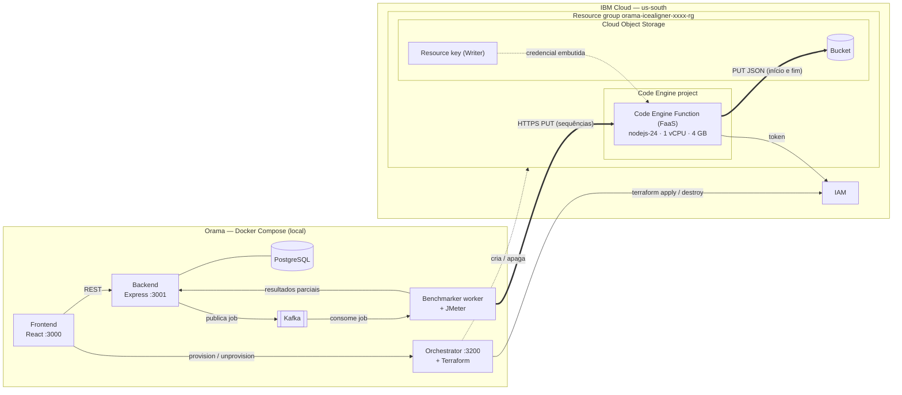
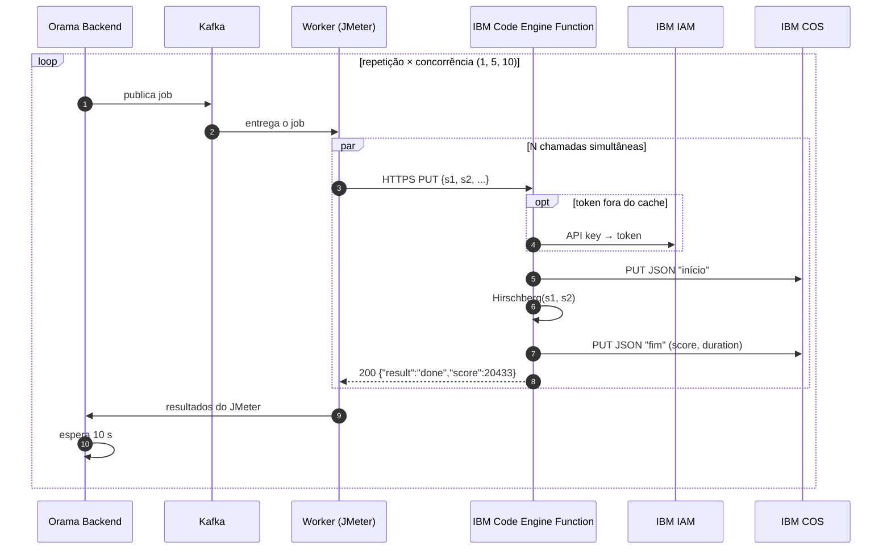

# icealigner: alinhamento de sequências genéticas no IBM Code Engine Functions

Caso de uso feito para a tarefa da **Professora Aleteia Araujo**: levar para a IBM Cloud o benchmark de biologia que o Orama já tem em AWS, GCP e Azure (`lambdaaligner`, `gcfaligner`, `azfaligner`).

> **Não usamos AWS Lambda.** Este caso roda inteiramente no FaaS da IBM, o **IBM Cloud Code Engine Functions**, e grava os resultados no **IBM Cloud Object Storage (COS)**. A Lambda só aparece aqui como referência: é de onde vêm o algoritmo e as sequências do caso original.

> **Volume reduzido nestas primeiras rodadas.** As sequências são as mesmas do benchmark original, mas há menos repetições e menos concorrência (veja a tabela abaixo). O objetivo agora é validar o caso de uso na IBM. A carga completa fica para uma rodada seguinte.

## O que a função faz

1. Recebe por `PUT` dois trechos de DNA do gene **spike do SARS-CoV-2**, das amostras `OK084631.1` e `OK084572.1`, com 4.114 e 4.123 bases. São as mesmas sequências dos benchmarks de AWS e GCP.
2. Alinha as duas sequências com o algoritmo de **Hirschberg** (alinhamento global, versão de Needleman-Wunsch com memória linear).
3. Grava um JSON no **COS** duas vezes: no início e no fim. O JSON final traz as sequências alinhadas, o score, `started_at`, `finished_at` e `duration`, em segundos.

O caminho no bucket segue o padrão dos outros alinhadores:
`<service>/repetition_<n>/concurrence_<n>/hirschberg-<execid>_<timestamp>.json`.

A comparação de DNA é só a carga de trabalho. A pergunta do benchmark é como uma tarefa científica que consome CPU se comporta no FaaS da IBM em relação aos outros provedores.

## Volume reduzido em relação ao original

| | Original (`lambdaaligner`/`gcfaligner`) | `icealigner` (esta rodada) |
|---|---|---|
| Plataforma | AWS Lambda / Google Cloud Functions | **IBM Code Engine Functions** |
| Sequências | 4.114 e 4.123 bases | **as mesmas** |
| Configurações | 6 memórias (512 MB a 3 GB) | 1 configuração: **1 vCPU / 4 GB** |
| Concorrência | 1, 20, 40, 60, 80, 100 | **1, 5, 10** |
| Repetições | 10 | **3** |
| Invocações por benchmark | 3.010 | **48** |

Para voltar ao volume original, troque `repetitions` e `concurrences` do benchmark `630` em `src/backend/src/database/seeds/3_4_benchmarks_ibm.js`.

## Por que Node.js e não Python

Os alinhadores de AWS e GCP são escritos em Python. Na conta IBM usada (`ibmcloud ce fn runtimes`, em outubro de 2026), o único runtime gerenciado disponível para funções é **`nodejs-24`**. Por isso o Hirschberg foi portado para JavaScript a partir de `lambdaaligner/faas/aws/put/alignment/alignment.py`, mantendo os mesmos pesos (match `+5`, substituição `-100`, gap `-3`).

A versão Node produz **exatamente o mesmo alinhamento e o mesmo score** que a versão Python, verificado com 500 bases, 1.000 bases e as sequências completas de 4.114 e 4.123 bases (score `20433`). A diferença está no desempenho: localmente (Apple M4 Max), a sequência completa leva cerca de 4,9 s em Python e cerca de 0,13 s em Node. **Ao comparar com Lambda e GCF, lembre que a linguagem também mudou**, não só o provedor.

## Estrutura

```
icealigner/
  blueprints/ibm/
    provider.tf, faas-basic.tf, cos.tf   # copiados do ice2cos (resource group, projeto Code Engine, COS + bucket + credencial)
    variables.tf                          # region, cpu (padrão "1"), memory (padrão 4 GB)
    faas-put.tf                           # ibm_code_engine_function, runtime nodejs-24, código inline
    outputs.tf                            # ibm_put_url (nome esperado pelo orchestrator/scripts/getUrls.sh)
  faas/ibm/put/index.js                   # função em arquivo único: Hirschberg + upload para o COS
```

Observações de implementação:

- **Arquivo único.** A função inline do Code Engine aceita só um arquivo, por isso o algoritmo está embutido no `index.js`.
- **Sem dependências.** O upload para o COS é feito por `fetch` com token IAM, como no `ice2cos`. O token é reaproveitado enquanto a instância está quente.
- **Bucket.** A função grava no bucket criado pelo Terraform (injetado no lugar de `XXX_BUCKET_XXX`) e ignora o parâmetro `bucket` do benchmark.
- **Corpo da requisição.** A função lê o JSON de `body`, de `__ce_body` (em base64) ou dos parâmetros, como o `extractJsonBody` do `ice2cos`.

## Cadastro no banco (seeds)

- Caso de uso `430`, "ICE (1 vCPU / 4GB) with sequence aligner US-South", em `2_4_usecases_ibm.js`.
- Benchmark `630`, "IBM ICE 1vCPU align (reduced)", em `3_4_benchmarks_ibm.js`.

## Como rodar

1. Em `src/`, copie `.env-example` para `.env` e preencha `IBMCLOUD_API_KEY` (crie a chave com `ibmcloud iam api-key-create orama-key --file ~/orama-key.json`). No Docker Desktop, deixe `HOSTNAME=host.docker.internal` e adicione `127.0.0.1 host.docker.internal` ao `/etc/hosts` (veja a seção de problemas abaixo).
2. Suba o ambiente e cadastre os seeds:
   ```bash
   cd src
   docker compose up -d
   docker compose exec backend knex seed:run
   ```
   Se o banco já tem dados, o `seed:run` pode conflitar com os ids existentes. Nesse caso, insira só o caso de uso `430` e o benchmark `630`.
3. Abra http://localhost:3000, vá ao caso de uso **"ICE (1 vCPU / 4GB) with sequence aligner US-South"** e provisione. O Terraform cria o resource group, o projeto Code Engine, o COS e a função.
4. Execute o benchmark **"IBM ICE 1vCPU align (reduced)"**.
5. Os resultados aparecem no Orama (tempo de resposta do JMeter) e no bucket do COS (`duration` e `score` de cada alinhamento).
6. Ao terminar, desprovisione o caso de uso para não deixar recursos na conta.

Teste rápido da função depois do provisionamento, sem passar pelo Orama:

```bash
curl -X PUT "$IBM_PUT_URL" -H 'Content-Type: application/json' \
  -d '{"s1":"ACGTTGCA","s2":"ACGTTTGCA","t1":"a","t2":"b","service":"ice-1vcpu","concurrence":"1","repetition":"1","execid":"teste"}'
# {"result":"done","duration":...,"score":...}
```

## Arquitetura



Execução de uma chamada do benchmark:



## Resultados da primeira rodada (28/10/2026)

Os dois testes rodaram na conta IBM Cloud do autor, região us-south.

**1. Chamada isolada (Function criada pela CLI e, depois, pelo Terraform do Orama):**

| | CLI (`ibmcloud ce fn create`) | Orama (Terraform) |
|---|---|---|
| Score | `20433` ✅ | `20433` ✅ |
| Alinhamento (`duration`) | 1,87 s | 1,38 s |
| Tempo total no cliente | 2,82 s | 2,29 s |

**2. Benchmark `630` pelo Orama** (execução das 01:42:25 às 01:45:11 UTC, 2m46s no total), com tempos ponta a ponta medidos pelo JMeter:

| Concorrência | Chamadas | Erros | Média | Mediana | Mín. | Máx. |
|---|---|---|---|---|---|---|
| 1 | 4* | 0 | 2,46 s | 2,40 s | 2,27 s | 2,76 s |
| 5 | 15 | 0 | 2,94 s | 2,92 s | 2,60 s | 3,35 s |
| 10 | 30 | 0 | 3,43 s | 3,48 s | 3,00 s | 3,92 s |

\* 3 repetições mais 1 chamada de aquecimento (`warm_up: 1`).

- **49 chamadas, 0 erros**, todas com HTTP 200. O provisionamento pelo Terraform levou cerca de 3 minutos (o projeto Code Engine levou 1m41s e a Function, 1m02s).
- O tempo sobe cerca de 0,5 s a cada nível de concorrência. Com só 3 repetições, ainda não dá para afirmar se o aumento vem de cold start ou de disputa por recursos. Uma rodada com mais repetições deve responder isso.

## Problemas encontrados ao subir o Orama (e correções)

| Sintoma | Causa | Correção |
|---|---|---|
| Build do `orchestrator` falha no `apt-get` (exit code 100, 404 em `bullseye-security`) | A imagem `node:16.10.0-bullseye-slim` usa o Debian 11, cujos pacotes de segurança saíram do espelho | Base trocada para `node:20-bookworm-slim` (neste PR) |
| `orama-kafka-dev is unhealthy` | `.env-example` tinha `HOSTNAME=192.168.0.10#dont use localhost`, e o compose lê o comentário como parte do valor | `.env-example` corrigido, com o comentário em linha própria e o padrão `host.docker.internal` (neste PR) |
| Kafka ou backend não alcançam o IP da máquina (timeout) no Docker Desktop do Mac | Os containers não conseguem acessar o IP da rede local do host | Usar `HOSTNAME=host.docker.internal`. Para o navegador, adicione `127.0.0.1 host.docker.internal` ao `/etc/hosts` |
| Backend reinicia com `KnexTimeoutError` e o Postgres registra `database "orama" does not exist` | Na primeira subida no Mac, o Postgres falhou por permissão da pasta montada (`data directory has wrong ownership`) e não criou o banco | `docker exec orama-database-dev createdb -U orama orama`. As migrações rodam no próximo restart do backend |
| `localhost:3000` abre outro app | Outro processo escutando em `[::1]:3000` | Acesse por `http://127.0.0.1:3000` ou mude `FRONTEND_PORT` |
| README citava `IBM_CLOUD_API_KEY` | O compose lê `IBMCLOUD_API_KEY` | README corrigido (neste PR) |

## Validado até aqui

- `terraform validate` do blueprint: OK.
- O alinhamento em Node é idêntico ao da versão Python original nos três tamanhos testados.
- A função foi executada localmente com IAM e COS simulados (corpo direto, como string e via `__ce_body`; 400 com campo faltando ou JSON inválido).
- Function criada manualmente pela CLI e chamada com as sequências completas: `score 20433` ✅.
- **Provisionamento pelo Orama (Terraform) e benchmark `630` executados com sucesso:** 49 chamadas e 0 erros (veja os resultados acima).
